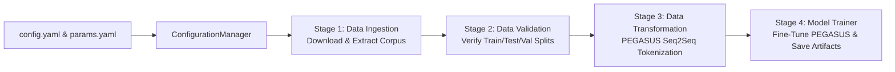

# Abstractive Text Summarization Pipeline (PEGASUS + Hugging Face)

[](https://www.python.org/downloads/)
[](https://huggingface.co/google/pegasus-cnn_dailymail)
[](LICENSE)

A modular, configuration-driven **abstractive dialogue & text summarization MLOps pipeline** fine-tuning [`google/pegasus-cnn_dailymail`](https://huggingface.co/google/pegasus-cnn_dailymail) on the **SAMSum** conversational dataset using **PyTorch**, **Hugging Face Transformers**, typed configuration entities, and **Docker**.

---

## Pipeline Architecture

The training system decouples YAML configuration (`config/config.yaml`) and model hyperparameters (`params.yaml`) from stage execution (`main.py`):



### Repository Structure

```text
.
├── config/
│   └── config.yaml                  # Artifact paths, dataset URL & model checkpoint
├── params.yaml                      # Seq2Seq training hyperparameters (epochs, batch size, warmup)
├── src/textSummarizer/
│   ├── components/                  # Modular stage implementations (ingestion, validation, transformation, trainer)
│   ├── config/                      # ConfigurationManager resolving YAML + entity dataclasses
│   ├── constants/                   # Immutable path constants
│   ├── entity/                      # Typed @dataclass configs per pipeline stage
│   ├── logging/                     # Centralized structured logger
│   ├── pipeline/                    # Stage-01 through Stage-04 execution orchestrators
│   └── utils/                       # Common YAML & filesystem utilities
├── main.py                          # End-to-end 4-stage pipeline entrypoint
├── DOCKERFILE                       # Containerized training/runtime image
├── requirements.txt                 # Python package dependencies
└── setup.py                         # Editable local package definition
```

---

## Quick Start

```bash
git clone https://github.com/kenseiAmit/Text-Summarizer-Project.git
cd Text-Summarizer-Project

python3 -m venv .venv
source .venv/bin/activate
pip install -r requirements.txt
pip install -e .

# Execute full 4-stage ingestion, validation, transformation & training pipeline
python main.py
```

---

## License

Released under the [MIT License](LICENSE).
