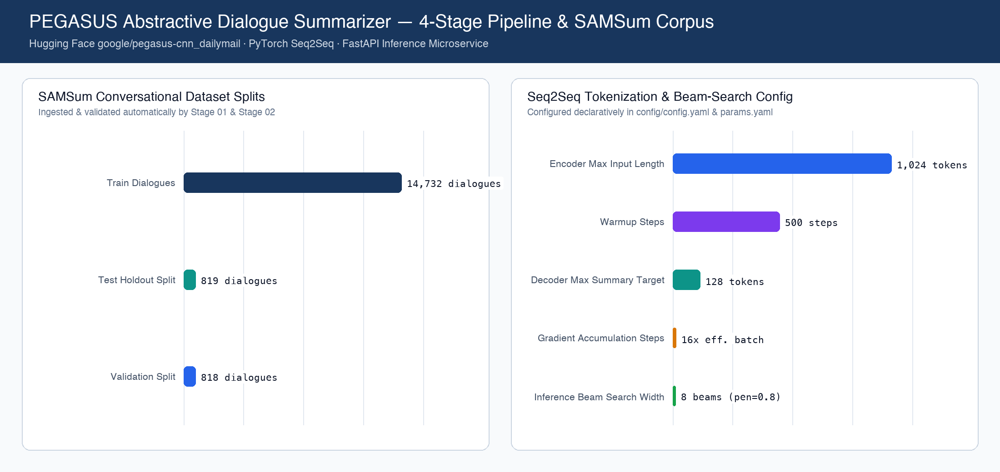
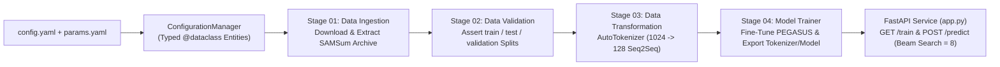

# Abstractive Text Summarization Pipeline (PEGASUS + Hugging Face + FastAPI)

[](https://www.python.org/downloads/)
[](https://huggingface.co/google/pegasus-cnn_dailymail)
[](https://fastapi.tiangolo.com/)
[](LICENSE)

Modular, configuration-driven **abstractive dialogue & document summarization MLOps pipeline** fine-tuning [`google/pegasus-cnn_dailymail`](https://huggingface.co/google/pegasus-cnn_dailymail) on the **SAMSum** conversational corpus (`16,369` multi-party dialogues) using **PyTorch**, **Hugging Face Transformers**, immutable `@dataclass` stage entities, structured logging, **FastAPI** serving (`app.py`), and **Docker**.



---

## 1. Four-Stage Modular Pipeline Architecture

The system strictly separates declarative YAML configuration (`config/config.yaml`, `params.yaml`) from immutable entity contracts (`src/textSummarizer/entity/`) and stage execution (`main.py`):



---

## 2. Training & Decoding Hyperparameters (`params.yaml`)

| Parameter | Configured Value | Architectural Role |
| :--- | :---: | :--- |
| **Base Checkpoint** | `google/pegasus-cnn_dailymail` | Gap-sentence pre-trained encoder-decoder transformer (`568M` params) |
| **Dataset (`SAMSum`)** | `14,732` train / `818` val / `819` test | Human-annotated messenger dialogue summarization benchmark |
| **Max Input / Target Tokens** | `1,024` / `128` | Captures full multi-turn threads while enforcing concise summaries |
| **Effective Batch Scaling** | `per_device=1` × `grad_accum=16` | Fits 1,024-token Seq2Seq training within single-GPU VRAM budgets |
| **Warmup & Weight Decay** | `500` steps / `0.01` | Stabilizes early cross-attention fine-tuning |
| **Beam Search Decoding** | `num_beams=8`, `length_penalty=0.8` | Balances fluency and compression without extractive repetition |

---

## 3. Sample Dialogue Summarization Output (`POST /predict`)

```text
Input Dialogue:
   Hannah: Hey, do you have Betty's number?
  Amanda: Lemme check. Sorry, can't find it. Ask Larry, he called her last time we were at the park together.
  Hannah: I don't know him well.
  Amanda: Don't be shy, he's very nice! Or text her on Messenger.

Generated Abstractive Summary (PEGASUS, beams=8, length_penalty=0.8):
  Hannah needs Betty's phone number, which Amanda doesn't have. Amanda suggests asking Larry, who called Betty recently, or messaging her directly.
```

---

## 4. Repository Structure

```text
Text-Summarizer-Project/
├── config/config.yaml               # Artifact directories, dataset source URL & checkpoint IDs
├── params.yaml                      # Seq2Seq trainer & beam-search hyperparameters
├── main.py                          # Sequential 4-stage training pipeline orchestrator
├── app.py                           # FastAPI microservice (/docs, /train, /predict)
├── DOCKERFILE                       # Containerized runtime image
├── reserach/                        # Stage-by-stage Jupyter experimentation notebooks (01..04 + ROUGE eval)
└── src/textSummarizer/
    ├── components/                  # DataIngestion, DataValidation, DataTransformation, ModelTrainer
    ├── config/configurations.py     # ConfigurationManager factory
    ├── entity/                      # Frozen @dataclass stage configurations
    ├── logging/                     # Timestamped file + stdout logger
    └── pipeline/                    # stage_01 .. stage_04 runners
```

---

## 5. Quick Start

```bash
git clone https://github.com/kenseiAmit/Text-Summarizer-Project.git
cd Text-Summarizer-Project

python3 -m venv .venv
source .venv/bin/activate
pip install -r requirements.txt
pip install -e .

# Run end-to-end 4-stage training pipeline
python main.py

# Launch FastAPI inference server (http://localhost:8080/docs)
python app.py
```

## License

Released under the [MIT License](LICENSE).
